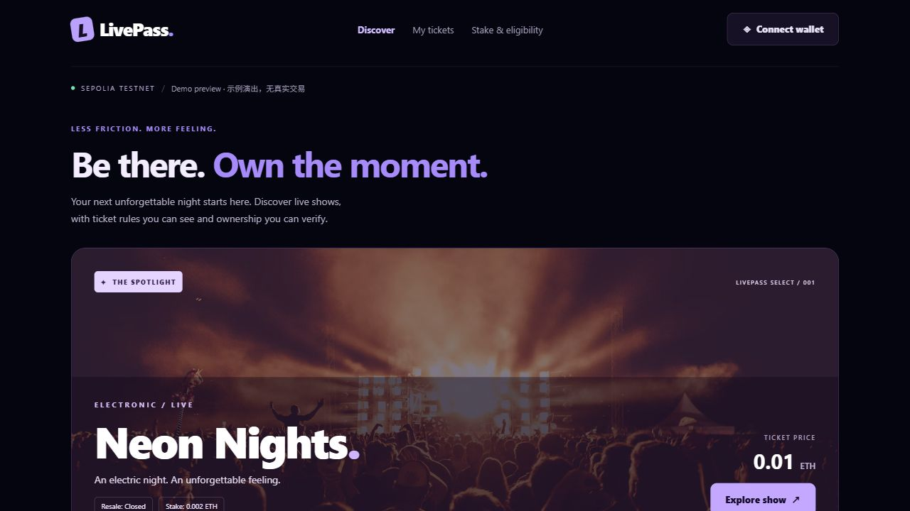

# LivePass — Concert ticketing frontend

LivePass 是基于 Expo / React Native 的演唱会票务前端。本次将原 LUNAR NFT 市场首页改为演出发现与购票预览，并升级至 Expo SDK 58，以匹配 SDK 58 的 Expo Go。

## 本次改动

### LivePass 首页

- 使用深色舞台背景、紫色品牌、精选演出主视觉和响应式海报卡片，替换 NFT 竞价、藏品榜单、地板价和创作者铸造内容。
- 示例演出覆盖 Closed / Open / Detect 三种转售策略；展示 ETH 票价、开售/停售状态和是否需要预存。
- “All shows / On sale” 筛选支持从三场示例中筛选出两场在售演出；Discover 可滚动至演出区。
- 演出卡片和精选演出支持详情弹窗，展示票价、转售规则、预存说明及当前接入状态。
- 钱包、票夹、预存资格及使用说明入口提供说明弹窗；购票按钮在合约未配置时保持禁用，不生成模拟成功交易。
- 手机窄屏改用单列卡片与紧凑导航；图片加载失败时保留背景占位。
- Web 导航使用 Expo Router Slot，由首页自己的响应式导航替换原来覆盖内容的 Expo Starter 浮动标签栏。原生导航保留现有页面结构。

### 数据与能力边界

- `src/data/livepass.ts` 单独维护演出类型、三场演示数据和策略解释，便于后续替换为链上数据层。
- 当前是明确标注的 Demo preview，未配置合约地址、ABI、部署区块或 ethers 集成。
- 钱包真实连接、按 owner 分流、购票交易、预存/取回、链上票夹、溯源和验票仍需后续实现。本次弹窗不代表这些功能已经接入。
- 示例海报通过外部图片 URL 加载，需要网络；演出信息为演示数据。
- 每钱包每场限购不等于实名限购；截图不是入场凭证；仅以 Sepolia 测试网为目标，无真实资金。

### Expo SDK 58 升级

- Expo 升至 `~58.0.19`，React/React DOM 升至 `19.3.0`，React Native 升至 `0.88.0`。
- Router、Expo 模块、Gesture Handler、Reanimated、Worklets、Screens、Safe Area Context、React Native Web 和 React 类型按 Expo 兼容清单对齐；更新 npm 锁文件。
- 原生标签导航导入从 `expo-router/unstable-native-tabs` 改为稳定的 `expo-router/native-tabs`。
- 首页 ScrollView ref 使用组件实例类型，适配新版 React Native；主题选择处理 `null` 并移除旧版 `unspecified` 分支。
- 本机旧依赖备份位于 `.expo/sdk57-upgrade-backup`，属于忽略文件，不上传仓库。

### 项目专用 skill

`.agents/skills/livepass-frontend/` 包含入口规则、调用元数据、需求原文快照与项目适配说明。后续可用 `$livepass-frontend` 指导页面实现与需求核对。

需求快照来自 2026-10-19 交付包；其中 Expo 57 为技能创建时的代码基线。当前实际依赖已升级到 SDK 58，后续开发应核对 `package.json` 与 SDK 58 文档。仓库 AGENTS.md 中原 SDK 57 阅读要求仍保留，升级时同时查阅了 SDK 57、58 和官方迁移说明。

## 运行与手机预览

使用满足 Expo SDK 58 要求的 Node.js：22.13+（22 系列）、24.3+（24 系列）或26+。

```powershell
npm.cmd ci
npm.cmd run start -- --clear
```

手机与电脑连接同一个 Wi-Fi，用支持 SDK 58 的 Expo Go 扫描新二维码。升级后先 Ctrl+C 停止旧服务，再执行上述启动命令。PowerShell 下使用 `npm.cmd` 可避开 npm.ps1 的脚本执行策略限制。

Web 开发预览：

```powershell
npm.cmd run web -- --host lan
```

## 验证记录与限制

- TypeScript：`node node_modules/typescript/bin/tsc --noEmit` 通过。
- Expo 依赖兼容性检查：`npx.cmd expo install --check` 通过（本地兼容映射）。
- Expo Doctor：20/20 检查通过。
- SDK 58 iOS Hermes bundle 与 Web 静态导出：`npx.cmd expo export --platform ios --platform web --clear` 通过。
- 首页浏览器检查：开售筛选 3→2、演出详情、禁用购票状态，以及390px宽度的单列布局通过（首页实现阶段完成）。
- 尚未在真实 iPhone 上运行升级后的项目；iOS bundle 成功不等于实机验证完成，也不等于生成可安装 IPA。
- npm audit 仍报告5项 high 记录，涉及 Expo CLI 的 node-forge、zod 依赖链；未使用会将 Expo 回退到旧主版本的 `npm audit fix --force`。Expo Doctor 通过不等于依赖漏洞审计通过。

## 首页预览



---

## 原模板说明

# Welcome to your Expo app 👋

This is an [Expo](https://expo.dev) project created with [`create-expo-app`](https://www.npmjs.com/package/create-expo-app).

## Get started

1. Install dependencies

   ```bash
   npm install
   ```

2. Start the app

   ```bash
   npx expo start
   ```

In the output, you'll find options to open the app in a

- [development build](https://docs.expo.dev/develop/development-builds/introduction/)
- [Android emulator](https://docs.expo.dev/workflow/android-studio-emulator/)
- [iOS simulator](https://docs.expo.dev/workflow/ios-simulator/)
- [Expo Go](https://expo.dev/go), a limited sandbox for trying out app development with Expo

You can start developing by editing the files inside the **app** directory. This project uses [file-based routing](https://docs.expo.dev/router/introduction).

## Get a fresh project

When you're ready, run:

```bash
npm run reset-project
```

This command will move the starter code to the **app-example** directory and create a blank **app** directory where you can start developing.

### Other setup steps

- To set up ESLint for linting, run `npx expo lint`, or follow our guide on ["Using ESLint and Prettier"](https://docs.expo.dev/guides/using-eslint/)
- If you'd like to set up unit testing, follow our guide on ["Unit Testing with Jest"](https://docs.expo.dev/develop/unit-testing/)
- Learn more about the TypeScript setup in this template in our guide on ["Using TypeScript"](https://docs.expo.dev/guides/typescript/)

## Learn more

To learn more about developing your project with Expo, look at the following resources:

- [Expo documentation](https://docs.expo.dev/): Learn fundamentals, or go into advanced topics with our [guides](https://docs.expo.dev/guides).
- [Learn Expo tutorial](https://docs.expo.dev/tutorial/introduction/): Follow a step-by-step tutorial where you'll create a project that runs on Android, iOS, and the web.

## Join the community

Join our community of developers creating universal apps.

- [Expo on GitHub](https://github.com/expo/expo): View our open source platform and contribute.
- [Discord community](https://chat.expo.dev): Chat with Expo users and ask questions.
